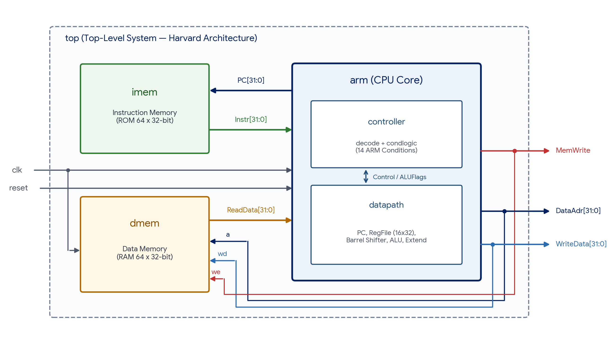
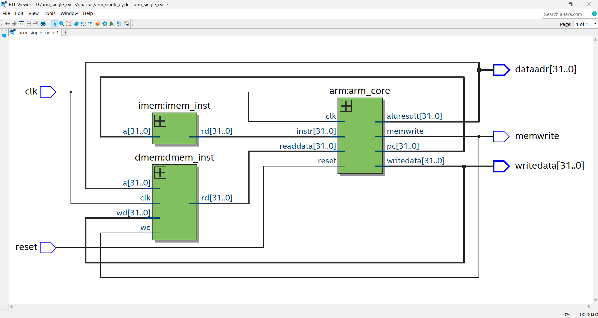
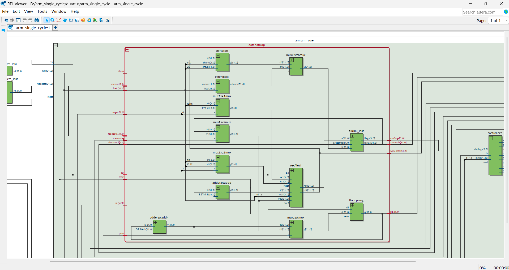
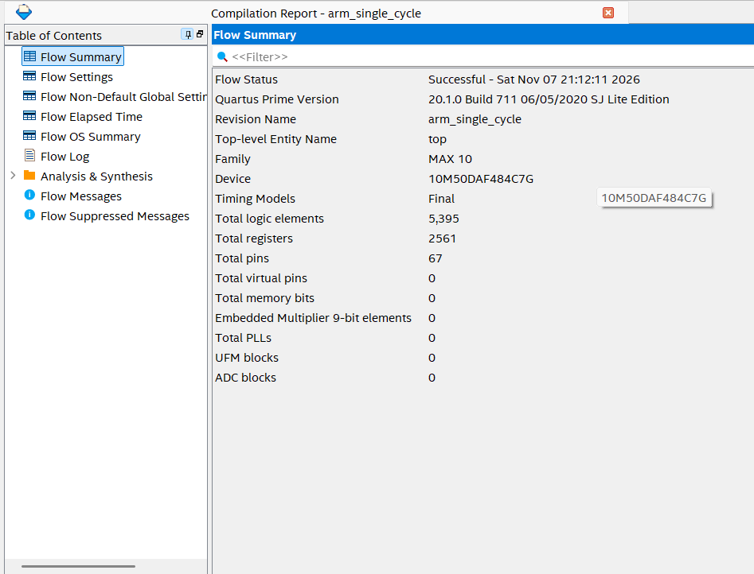
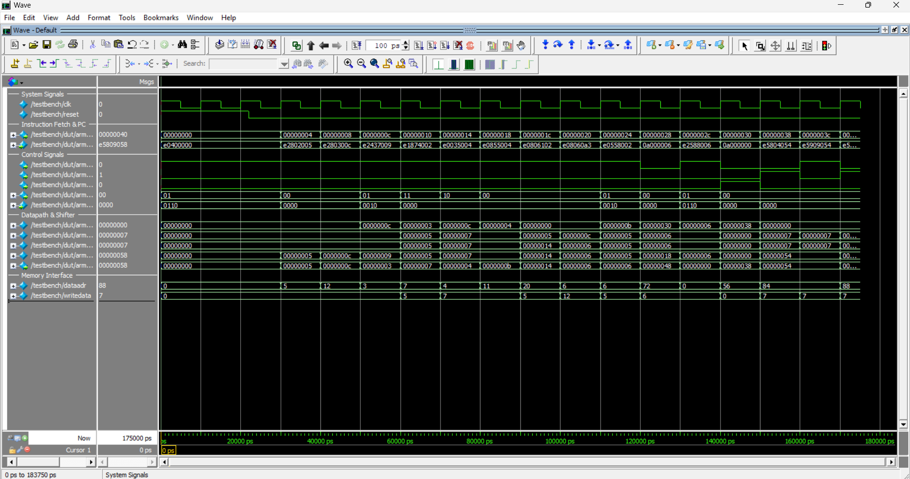
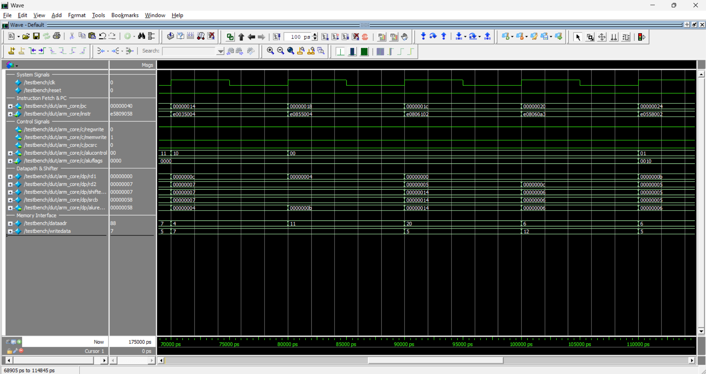
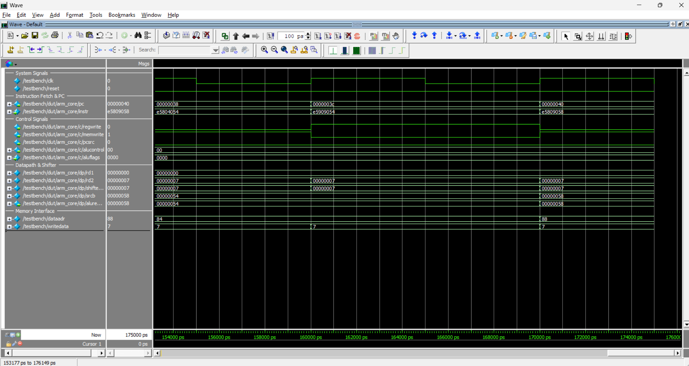
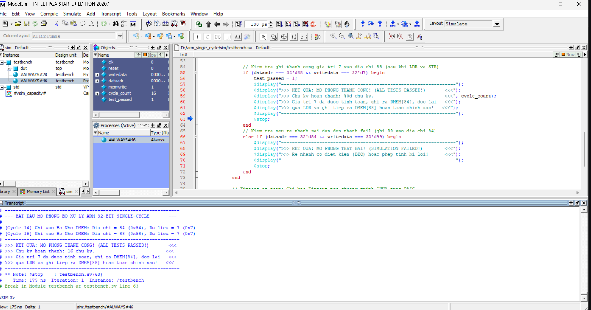

# 32-bit Single-Cycle ARM Processor in SystemVerilog

-blue.svg)
-orange.svg)


-brightgreen.svg)


A complete, fully synthesizable **32-bit Single-Cycle ARM Processor** implemented in **SystemVerilog**, featuring an integrated **Hardware Barrel Shifter** and full **14-Condition Code Evaluation**. Synthesized targeting the **Intel MAX 10 FPGA (`10M50DAF484C7G`)** on the **Terasic DE10-Lite** board, and verified via a self-checking testbench in **ModelSim**.

📄 **Official Course Final Report:** [`24022854_NguyenTienDat_BaoCaoCuoiKi_SingleCycleProcesser.pdf`](24022854_NguyenTienDat_BaoCaoCuoiKi_SingleCycleProcesser.pdf)

---

## 🏛️ System Architecture

The processor follows the **Harvard Architecture** with separate instruction and data memory paths, enabling single-cycle fetch and execute operations ($CPI = 1$).



### Core Highlights:
- **Architecture:** Single-Cycle Harvard Microarchitecture (`arm_core`, `imem`, `dmem`).
- **Core Instruction Set (ARMv4 Subset):**
  - **Data Processing:** `ADD`, `SUB`, `AND`, `ORR` (with immediate and register operands, flag updates via $S$-bit).
  - **Memory Operations:** `LDR`, `STR` (positive 12-bit immediate offsets).
  - **Branching:** `B` (PC-relative branching via ALU: $PC + 8 + \text{ExtImm}$).
- **Hardware Enhancements:**
  - **32-bit Barrel Shifter (`shifter.sv`):** Hardware decoding of `Instr[11:5]` supporting all 4 ARM shift operations within the execute cycle:
    - `LSL` (Logical Shift Left)
    - `LSR` (Logical Shift Right)
    - `ASR` (Arithmetic Shift Right - sign-extended)
    - `ROR` (Rotate Right)
  - **14-Condition Code Evaluator (`condcheck.sv`):** Full hardware evaluation of all 14 ARM conditions (`EQ`, `NE`, `CS/HS`, `CC/LO`, `MI`, `PL`, `VS`, `VC`, `HI`, `LS`, `GE`, `LT`, `GT`, `LE`, and unconditional `AL`).
- **Synthesis Quality:** 100% synthesizable SystemVerilog with **0 unintended latches** and clean synchronous reset.

---

## 🔬 Hardware Synthesis & RTL Netlist

### 1. Top-Level RTL Netlist Viewer
Generated from **Intel Quartus Prime Lite Edition 20.1** showing the top-level interconnection between `arm:arm_core`, `imem:imem_inst`, and `dmem:dmem_inst`:



### 2. Datapath with Integrated Barrel Shifter
Zooming into `arm:arm_core` $\rightarrow$ `datapath:dp` shows the **`shifter:sh`** module placed at the second register file read port (`RD2`), feeding directly into input `d0` of the ALU source multiplexer (`mux2:srcbmux`):



### 3. FPGA Resource Utilization (Flow Summary)
Targeting the **Intel MAX 10 FPGA (`10M50DAF484C7G`)** on the **Terasic DE10-Lite** development board:



| Resource Metric | Used | Total Available | Utilization (%) |
| :--- | :---: | :---: | :---: |
| **Total Logic Elements (LEs)** | **5,395** | 49,760 | **11 %** |
| -- Combinational Functions | 4,947 | 49,760 | 10 % |
| -- Dedicated Logic Registers | 2,561 | 49,760 | 5 % |
| **Total Registers** | **2,561** | - | - |
| **Total Pins** | **67** | 360 | **19 %** |
| **Total Virtual Pins** | 0 | - | 0 % |
| **Total Memory Bits** | 0 | 1,677,312 | 0 % |
| **Unintended Latches** | **0** | 0 | **0 % (Clean Netlist)** |
| **Critical Path Delay ($T_c$)** | **$31.8\text{ ns}$** | - | **$f_{max} \approx 31.45\text{ MHz}$** |

---

## ⚡ Verification & Simulation Results

The processor was thoroughly verified using a **Self-checking Testbench (`testbench.sv`)** running a 21-instruction diagnostic assembly program from *Harris & Harris* (*Digital Design and Computer Architecture: ARM Edition*).

### 1. Full Simulation Timeline ($0 \div 180\text{ ns}$)
Complete single-cycle execution of all 21 test instructions terminating cleanly at cycle 20 ($175\text{ ns}$):



### 2. Hardware Barrel Shifter in Action
At $PC = \text{0x0000001C}$ (`ORR R5, R0, R2, LSL #2`), register $R2 = 5$ (`0000_0101b`) is shifted left by 2 bits in hardware, yielding `shifted_rd2 = 0x14` (decimal $20$) within the same clock cycle before entering the ALU:



### 3. Memory Access & Result Verification
At $PC = \text{0x00000040}$ ($170 \div 175\text{ ns}$), the processor executes `STR R9, [R0, #88]`, writing the verified calculation result $7$ to memory address $88$ (`memwrite = 1`):



### 4. Automated Self-Checking Testbench Log
The testbench detects the correct write of value $7$ to address $88$ and automatically issues `$stop` at line 63 of `testbench.sv`:



```text
[Cycle 14] Ghi vao Bo Nho DMEM: Dia chi = 84 (0x54), Du lieu = 7 (0x7)
[Cycle 16] Ghi vao Bo Nho DMEM: Dia chi = 88 (0x58), Du lieu = 7 (0x7)
----------------------------------------------------------------
>>> KET QUA: MO PHONG THANH CONG! (ALL TESTS PASSED!)       <<<
>>> Chu ky hoan thanh: 16 chu ky.                          <<<
>>> Gia tri 7 da duoc tinh toan, ghi ra DMEM[84], doc lai   <<<
>>> qua LDR va ghi tiep ra DMEM[88] hoan toan chinh xac!   <<<
----------------------------------------------------------------
** Note: $stop : testbench.sv(63)
Time: 175 ns
```

---

## 📁 Repository Structure

```text
├── docs/                        # Project documentation and visual assets
│   └── images/                  # High-resolution architectural and waveform figures
│       ├── arch_harvard_top.png
│       ├── rtl_viewer_top.png
│       ├── rtl_datapath_shifter.png
│       ├── quartus_flow_summary.png
│       ├── modelsim_wave_full.png
│       ├── modelsim_wave_shifter.png
│       ├── modelsim_wave_memory.png
│       └── modelsim_transcript_pass.png
├── quartus/                     # Intel Quartus Prime synthesis project
│   ├── arm_single_cycle.qpf     # Quartus Project File
│   ├── arm_single_cycle.qsf     # Quartus Settings File (Target: 10M50DAF484C7G)
│   └── memfile.dat              # Preloaded machine code memory file
├── sim/                         # ModelSim verification environment
│   ├── testbench.sv             # Self-checking automated testbench
│   ├── run_sim.do               # 1-click ModelSim automated run script
│   ├── memfile.dat              # 21-instruction test program
│   └── generate_memfile.py      # Assembly to machine code helper script
├── src/                         # Synthesizable SystemVerilog RTL source code
│   ├── top.sv                   # Top-level entity integrating CPU and memories
│   ├── arm.sv                   # Top-level CPU core (Controller + Datapath)
│   ├── controller.sv            # Top-level Control Unit
│   ├── decode.sv                # Decoder wrapper (Main + ALU + PC logic)
│   ├── maindec.sv               # Main decoder (Opcode decoding)
│   ├── aludec.sv                # ALU decoder & S-bit flag update logic
│   ├── condlogic.sv             # Conditional logic wrapper with Flag registers
│   ├── condcheck.sv             # 14 ARM condition code checking logic
│   ├── pclogic.sv               # Program counter destination & branch logic
│   ├── datapath.sv              # 32-bit execution datapath
│   ├── regfile.sv               # 16 x 32-bit Register File (R0-R14, R15 as PC+8)
│   ├── alu.sv                   # 32-bit Arithmetic Logic Unit
│   ├── shifter.sv               # 32-bit Barrel Shifter (LSL, LSR, ASR, ROR)
│   ├── extend.sv                # Immediate value sign/zero extender
│   ├── adder.sv                 # 32-bit parallel adder
│   ├── mux2.sv                  # Parameterized 2-to-1 Multiplexer
│   ├── flopr.sv                 # D Flip-Flop with asynchronous reset
│   ├── flopenr.sv               # D Flip-Flop with enable and asynchronous reset
│   ├── imem.sv                  # 64-word 32-bit Instruction ROM
│   └── dmem.sv                  # 64-word 32-bit Data RAM
├── 24022854_NguyenTienDat_BaoCaoCuoiKi_SingleCycleProcesser.pdf # Official Report (PDF)
├── REPORT_TEMPLATE.md           # Technical Project Report (Vietnamese Markdown)
├── .gitignore                   # Ignore Quartus/ModelSim build artifacts
└── README.md                    # Project documentation (English)
```

---

## 🚀 How to Run Simulation

### Using ModelSim:
1. Open **ModelSim**.
2. Run the automated DO script:
   ```tcl
   do D:/arm_single_cycle/sim/run_sim.do
   ```
3. The script will automatically:
   - Compile all 20 SystemVerilog source files in `src/` and `sim/testbench.sv`.
   - Load the simulation with optimized visibility.
   - Group waveforms into clean, color-coded functional categories.
   - Run the simulation until the self-checking condition triggers `$stop` at $175\text{ ns}$.
4. In the Wave window, press **`F`** to zoom full.

---

## 👨‍💻 Project Information

- **Student:** Nguyễn Tiến Đạt (Student ID: 24022854)
- **Instructors:** PGS.TS. Phạm Ngọc Quang, KS. Đỗ Đình Minh
- **Course:** Digital Design & Microprocessors (ELT3290)
- **Institution:** VNU University of Engineering and Technology (VNU-UET)
- **GitHub Repository:** [https://github.com/DkaRobotEngineer/arm-32bit-single-cycle-processor-](https://github.com/DkaRobotEngineer/arm-32bit-single-cycle-processor-)
